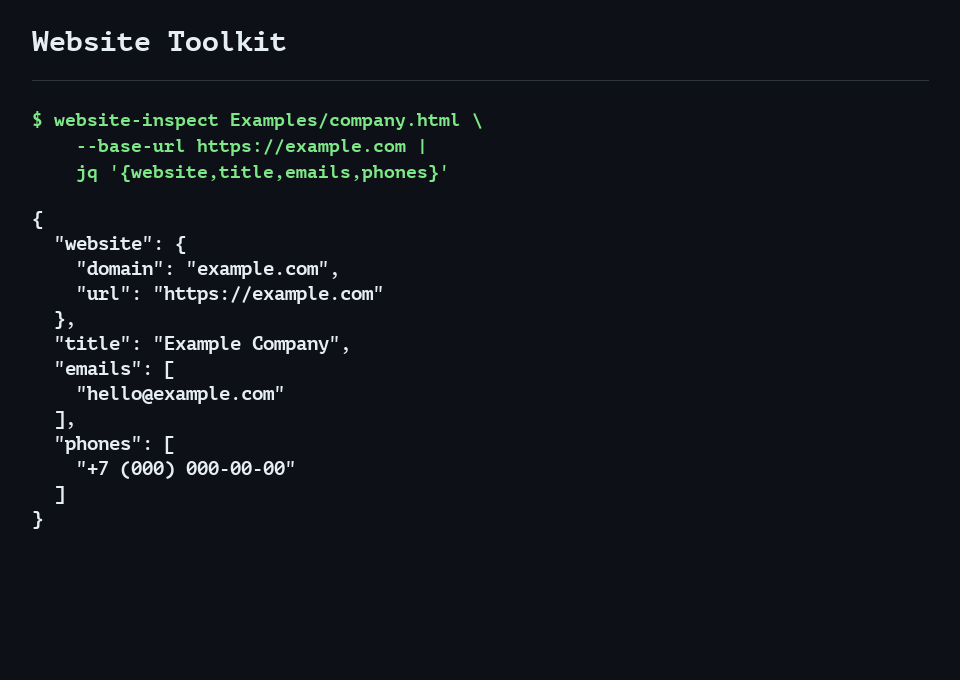

# Website Toolkit

Swift-библиотека обработки сайтов, выделенная из LeadForge: нормализация адресов, извлечение контактов, полезных страниц и социальных ссылок из HTML.

Автор: [Марк / MDRK Studio](https://mdrkstudio.ru).

<picture>
  <source media="(prefers-reduced-motion: no-preference)" srcset="docs/demo.gif">
  
</picture>

## Возможности

- Приведение адреса сайта к канонической форме, удаление меток и фрагментов.
- Заголовок и текст страницы, исключение содержимого script/style.
- Email из текста и mailto, российские телефоны из текста и tel.
- Ссылки на контакты, компанию, доставку и другие разделы того же сайта.
- Определение Telegram, WhatsApp, VK, OK и MAX по домену.
- Команда `website-inspect`, вывод результата в JSON.

Foundation, без сторонних зависимостей. Swift 6+, macOS 13+.

## Запуск примера

```bash
swift build
swift run website-inspect Examples/company.html --base-url https://example.com
```

`--base-url` нужен для разрешения относительных ссылок. Команда читает HTML с диска, сетевых запросов не делает. До 5 МБ, кодировка UTF-8.

## Использование библиотеки

Для проекта рядом добавь `.package(path: "../website-toolkit")` в `dependencies` своего Package.swift и `.product(name: "WebsiteToolkit", package: "website-toolkit")` в зависимости target.

```swift
import Foundation
import WebsiteToolkit

let site = WebsiteNormalizer.normalize("https://www.example.com/about?utm_source=demo")
print(site?.domain ?? "") // example.com

let html = "<title>Example</title><p>hello@example.com</p>"
let emails = WebsiteContentExtractor.contactEmails(in: html)
let title = WebsiteContentExtractor.title(in: html)
let links = WebsiteContentExtractor.importantLinks(
    in: html, baseURL: URL(string: "https://example.com")!
)
```

`normalize` по умолчанию возвращает адрес главной страницы без query. `keepPath: true` сохраняет путь и параметры, кроме известных tracking-меток. Поддерживаются HTTP/HTTPS, адреса с учётными данными отклоняются.

## Обработка HTML

Библиотека читает готовый HTML и извлекает текст, атрибуты mailto/tel и ссылки. JavaScript не выполняется. Контакты в изображениях и динамически загружаемых блоках пропускаются. Телефоны распознаются в формате +7/8.

## Лицензия

Авторский код - [PolyForm Noncommercial 1.0.0](LICENSE). Некоммерческое использование, изменения и распространение разрешены по её условиям. Сохраняйте LICENSE и [NOTICE](NOTICE).

Для коммерческого применения нужно разрешение [MDRK Studio](https://mdrkstudio.ru/contacts). Сторонние зависимости и ресурсы сохраняют собственные лицензии.
